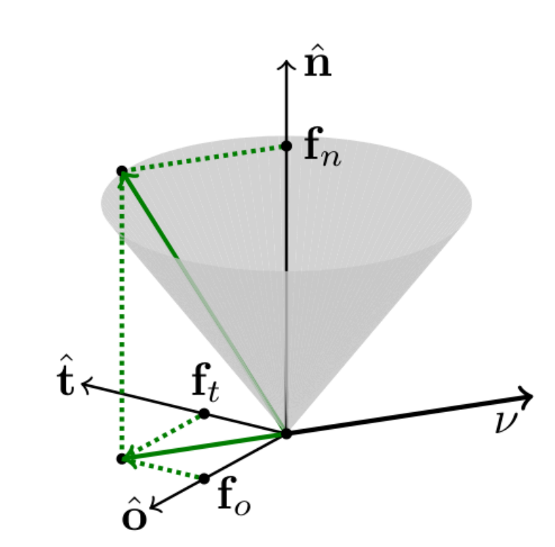

本文说明了物理引擎中的物理模型，以及将其转换成LCP问题和用PGS方法求解。

本文只讨论刚体模拟。

<!--more-->

# 瞬时间动力学的推导
## 刚体运动学关系

刚体的运动由其质心处的平动和以质心为原点的局部坐标系的转动组合而成。将平动位置$\pmb{x}$和转动的姿态（以四元数表示）$Q$放在一起组合成广义坐标：

$$
\pmb{q} = (\pmb{x}, Q) = 
\begin{bmatrix}
\pmb{x}^T & Q_x & Q_y & Q_z & Q_w
\end{bmatrix}
$$

而其对应的广义速度为：

$$
\pmb{u} = (\dot{\pmb{x}}, \dot{Q}) = (\pmb{v}, \pmb{\omega})
$$
对于平动，这里显然有 $\pmb{v} = \dot{\pmb{x}}$。对于转动，使用[刚体动力学中的四元数表示法](#四元数表示的无限小转动（四元数微分方程）)可以得到：

$$
\begin{aligned}
\dot{Q} & = G \pmb{\omega} \\
G & = 
\frac{1}{2}
\begin{bmatrix}
-Q_x & -Q_y & -Q_z \\
Q_w & Q_z & -Q_y \\
-Q_z & Q_s & Q_x \\
Q_y & -Q_x & Q_w \\
\end{bmatrix}
\end{aligned}
$$

这样，我们可以得到总的运动学关系：

$$
\begin{aligned}
\dot{q} & = Hu \\
H &= 
\begin{bmatrix}
1_{3\times 3} & 0 \\
0 & G \\
\end{bmatrix}
\end{aligned}
$$
## 约束

有两种[约束](#约束)：

1. 双边约束：$C(q_1, \cdots, q_n; u_1, \cdots, u_m, t)= 0$。比如各种Joint施加给连接到的刚体的约束。
2. 单边约束：$C(q_1, \cdots, q_n; u_1, \cdots, u_m, t) \ge 0$。比如碰撞分离的约束。

考虑两个半径为$r_1, r_2$，球心为$\pmb{x_1}, \pmb{x_2}$的球体，他们之间的约束为：

$$
C(\pmb{x_1}, \pmb{x_2}) = ||\pmb{x_1}, \pmb{x_2}|| - (r_1, + r_2)
$$

此时，如果$C(\pmb{x_1}, \pmb{x_2}) = 0$，那么这两个球相贴。

但如果$C(\pmb{x_1}, \pmb{x_2}) \ge 0$，那么两球是相离/相贴的，即非相交状态。

就是因为存在单边约束，我们才得将问题转换成LCP问题。如果只有双边约束，直接用拉格朗日乘子法就能解了。

## 库伦摩擦力（Coulomb’s Law of Friction）

即我们高中学的摩擦力，由库伦从大量实验中得出，也是仿真中最常用的模型。

在接触点处建立局部坐标系：法向$\pmb{n}$，切向$\pmb{t}, \pmb{o}$，这样**接触力**$\pmb{F}$可以写成：
$$
\begin{aligned}
\pmb{F} &= \pmb{F}_n \pmb{n} + \pmb{F}_t \\
\pmb{F}_t &= F_t \pmb{t} + F_o \pmb{O}
\end{aligned}
$$
注意这里是**接触力**而不是外力。接触力是接触面施加在物体上的反作用力。

库伦摩擦模型中，将摩擦力分为**静摩擦**和**动摩擦**：

$$
\pmb{F}_t =
\begin{cases}
& -F_t  & , ||\pmb{F_t}|| \le \mu F_n \\
& -\mu F_n \frac{\pmb{v}_t}{||\pmb{v}_t||}  & , ||\pmb{v}_t|| \gt 0
\end{cases}
$$
即，当物体没有移动时是静摩擦，摩擦力大小就是外力大小在切向下的投影。而移动之后就是动摩擦，摩擦力大小是$F_n \mu$，方向为移动的反方向。

这个公式在模拟的时候会有些问题：

* 不连续性：在静态/动态摩擦转换的临界点，摩擦力会发生突变，导致数值积分不稳定
* 静态不确定性：在静摩擦力状态下，摩擦力可以在允许范围内取任意值
* 零速度奇异性：当 $||\pmb{v}|| \rightarrow 0$时，摩擦力方向变得不确定

所以不能直接用这个公式，而是使用库伦条件和其对应的摩擦锥：

库伦条件规定了所有允许的接触力：
$$
 \begin{aligned}
C(F_n) = \{\pmb{F}_t : ||\pmb{F_t}|| & \le \mu F_n \} \\
F_n & \ge 0 \\
\end{aligned}
$$

这个公式在图像上构成一个朝向接触面外的锥体：

这个锥体的定义可以写得更清楚一些：

$$
\begin{aligned}
\mu^2 \pmb{F}_n^2 - \pmb{F}_t^2 - \pmb{F_o}^2 & \ge 0 \\
F_n & \ge 0 \\
\end{aligned}
$$

接触力有两种可能：

1. 在锥体内：此时是静摩擦
2. 在锥体面上：此时是动摩擦

这里可以发现，这个锥体和滑动速度$\pmb{v}_t$构成了一个互补条件：

| $\mu F_n - \|\pmb{F}_t\|$ | $\|\pmb{v}_t\|$ | 状态           |
| ------------------------- | --------------- | ------------ |
| >0（锥内）                    | =0              | 粘滞（静摩擦，未到极限） |
| =0（锥面）                    | =0              | 临界（将滑未滑）     |
| =0（锥面）                    | >0              | 滑动（动摩擦）      |
| >0（锥内）                    | >0              | **不可能**      |

可以将这种情况使用互补条件重述：

$$
0 \le \mu F_n - ||\pmb{F}_t|| \perp ||\pmb{v}||_t \ge 0
$$
这样就将问题转换成一个LCP问题。后面可以看到如何将其融入接触分离模型中。

库伦摩擦模型中还有一个**最大耗散原理**：

> 在所有满足摩擦锥的接触力中，实际发生的那个力，是**使能量耗散率最大**的那个。

用数学表示就是：

$$
\pmb{F}_t \in \arg \max_{\pmb{F}_t^{'} \in C(F_n)}(-\pmb{v}_t \cdot \pmb{F}_t^{'})
$$
等价的最小化表述为：

$$
\pmb{F}_t \in \arg \min_{\pmb{F}_t^{'} \in C(F_n)}(\pmb{v}_t \cdot \pmb{F}_t^{'})
$$

那么，对于单边接触，各项同性的库伦摩擦的最大耗散问题就是：

$$
\begin{aligned}
& \text{maximize} & -(\pmb{v}_t \pmb{F}_t) \\
& \text{subject to} & \mu^2 \pmb{F}_n^2 - \pmb{F}_t^2 \ge 0
\end{aligned}
$$
这就变成一个凸优化问题（目标函数是线性函数）。

**注意这里的自变量是向量$\pmb{F}_t$。**

但是这个问题不能用KKT条件。因为在锥顶$F_{n} = 0$处，可行域塌缩成一个点（锥尖尖那里），这导致约束变成$\pmb{F}_t^2 \le 0 \Rightarrow \pmb{F}_t = 0$。这样KKT的平稳性条件就变成$-\pmb{v}_t + \lambda \nabla \pmb{F}_t^2 = 0 \Rightarrow \pmb{v}_t = 0$。这样只要滑动速度不为0（这肯定会被触发），原问题就无解。

这时，可以使用更宽松的Fritz-John条件，这样可以写成：

$$
L: -\lambda_0 \nabla (\pmb{v}_t\pmb{F}_t) + \lambda_1 \nabla(\mu^2 \pmb{F}_n^2 - \pmb{F}_t^2)
$$

而$\nabla$算子是对$\pmb{F}_t = \begin{bmatrix}F_t \\ F_o\end{bmatrix}$求导，所以这个条件就变成：

$$
\begin{aligned}
& \frac{\partial L}{\partial F_t} = -\lambda_0 v_t - 2\lambda_1 F_t = 0 \\
& \frac{\partial L}{\partial F_o} = -\lambda_0 v_i - 2\lambda_1 F_i = 0 \\
\end{aligned}
$$

然后再给约束条件起个名$\alpha = \mu^2 \pmb{F}_n^2 - F_t^2 - F_i^2 \ge 0$，这样Fritz-John条件就是：

$$
\begin{aligned}
& \frac{\partial L}{\partial F_t} = -\lambda_0 v_t - 2\lambda_1 F_t = 0 \\
& \frac{\partial L}{\partial F_o} = -\lambda_0 v_i - 2\lambda_1 F_i = 0 \\
& \alpha = \mu^2 \pmb{F}_n^2 - F_t^2 - F_i^2 \ge 0 \\
& 0 \le \alpha \perp \lambda_1 \ge 0
\end{aligned}
$$

## 牛顿欧拉方程

将 [牛顿-欧拉方程](#牛顿-欧拉方程) 用矩阵的方式重新表述：

$$
\begin{aligned}
M(\pmb{q})\dot{\pmb{u}} & = g(\pmb{q}, \pmb{u}, t) \\
M & =
\begin{bmatrix}
m \pmb{1}_{3 \times 3} & \pmb{0} \\
\pmb{0} & \pmb{I} \\
\end{bmatrix} \\
g &= 
\begin{bmatrix}
\pmb{F} \\
\pmb{N} - \pmb{\omega} \times \pmb{I} \pmb{\omega}
\end{bmatrix}
\end{aligned}
$$

这里$M$是由普通质量和惯性张量$I$构成的质量矩阵（6x6的）。而$g$则是原本牛顿-欧拉方程的右边构成。

# 解瞬时动力学

